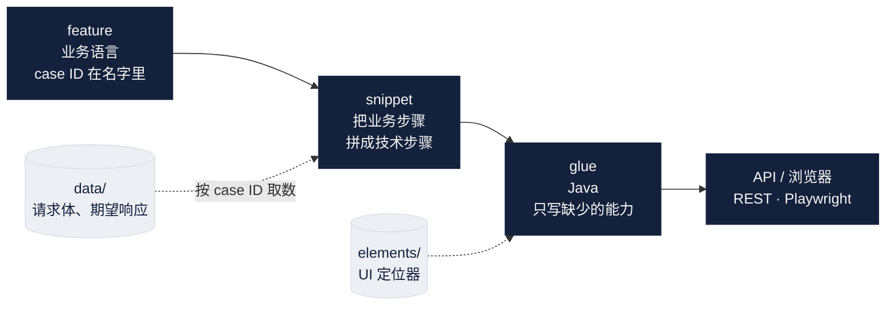
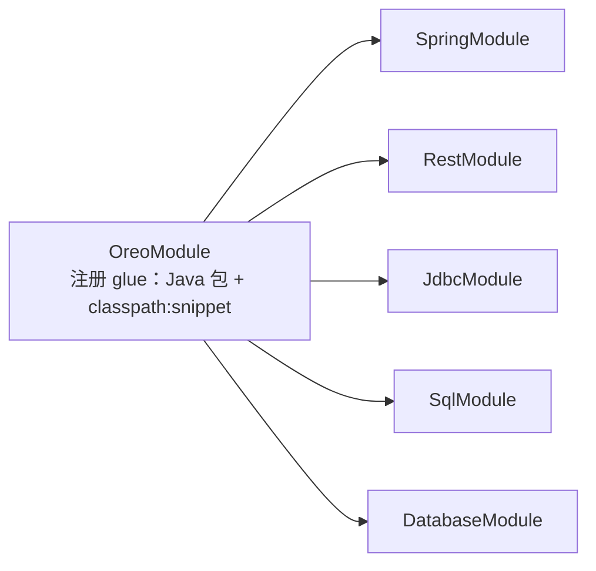
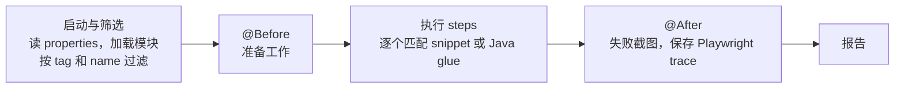
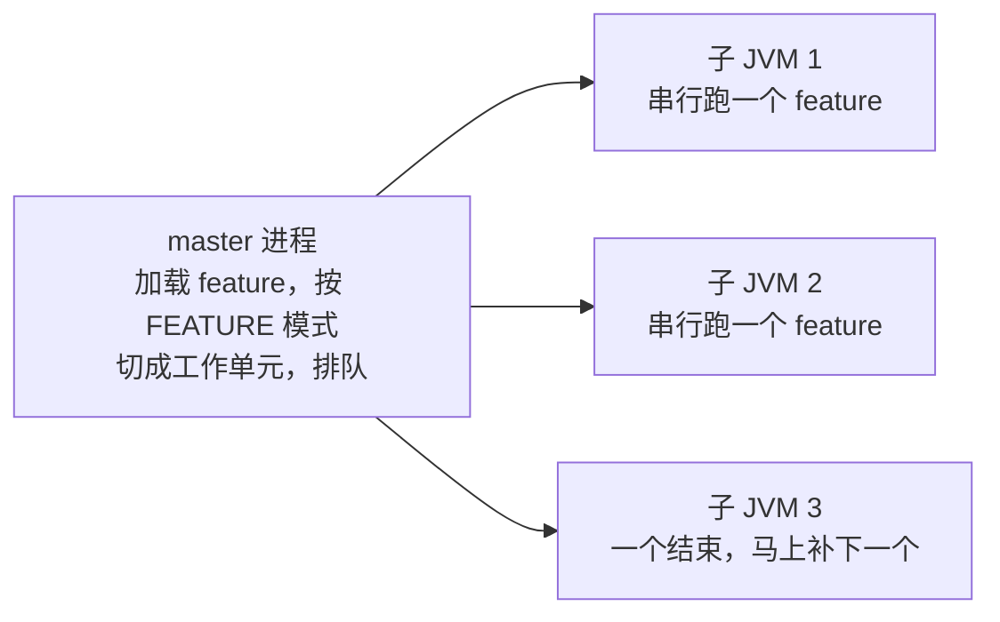
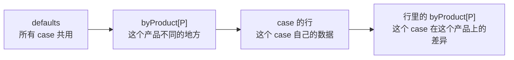
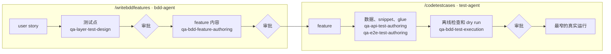

<!--
Confluence content for the onboarding KT (Chinese, for the team; the slides are docs/demo/oreo-kt-deck.html).
One "# Page" heading per Confluence page: create a parent page and one child page per section, then paste each part.
Confluence Cloud converts pasted Markdown; a ```mermaid block goes into a Mermaid macro (or redraw it with draw.io).
Rules and details stay in the repository: these pages summarize them and link to CLAUDE.md and docs/.
-->

# 页面：OREO E2E 自动化框架概览（父页面）

oreo-e2e 是 OREO FX 交易管理门户的端到端自动化测试项目，基于公司的 Genie 框架（Java + Cucumber）。它覆盖 trade 的整个生命周期：创建、审批、修改、取消、提前终止、分配、fixing 等。

**核心设计：事件是文件，产品是行。** 一个 lifecycle event 对应一个 feature 文件；上线一个新产品，只是在 Examples 里多一行，就能复用所有 event 的 case。产品一个个上线，这样加覆盖的成本最低。

| 子页面 | 内容 |
|---|---|
| 整体结构 | 分层、目录、API 和 UI 的分工、改动放在哪、追一个 case |
| Genie 运行机制 | 入口、模块、snippet、生命周期、配置、并行 |
| 测试数据 | case ID、四层合并、录制和离线检查 |
| AI 工作流 | 两条流水线、agent 和 skill |
| 红线与排查 | 最容易出事的五条规则，出问题先查哪一层 |

**规则以仓库为准。** 这些页面是概览，详细规则在仓库的 `CLAUDE.md` 和 `docs/` 里。两者不一致时，以代码和仓库文档为准。

---

# 页面：整体结构

## 一张图看懂分层

一个 case 从业务描述到真正调用系统，经过四层。越往左越接近业务语言，越往右越接近技术实现。技术细节只能往右沉，不能出现在 feature 里。



| 层 | 写什么 | 位置 |
|---|---|---|
| feature | 业务语言，case ID 写在 scenario 名字里 | `src/test/resources/features/{api,ui}` |
| snippet | 把业务步骤拼成技术步骤 | `src/main/resources/snippet/{api,ui}` |
| glue | Java，只写 snippet 和内置 step 做不到的能力 | `src/main/java/com/example/module/oreo/glue/{api,ui,hooks}` |
| API / 浏览器 | 实际调用系统：REST、Playwright | Genie 内置模块 |

两类数据不在这条链上，但会被各层使用：

- **data/**：请求体和录制的期望响应，按 case ID 取数。
- **elements/**：UI 定位器 JSON。选择器不进 feature，也不写死在 Java 里。

## 目录地图

| 目录 | 放什么 |
|---|---|
| `features/api`、`features/ui` | 按领域分目录，一个 event 一个 feature |
| `snippet/api` | API 的业务动作和结果断言 |
| `snippet/ui/flows`、`pages`、`components` | UI 三层：业务流程、页面原子操作、通用组件 |
| `glue/api`、`glue/ui`、`glue/hooks` | Java step 定义和 hooks |
| `data/api`、`ui`、`setup`、`dat`，`common.json` | case 数据、前置条件数据、产品 dat、公共块 |
| `elements/pages`、`components` | UI 定位器 |
| `*.properties` | 环境地址、账号和运行模式 |

snippet 和 glue 在 `src/main`；features、data、elements 和 properties 在 `src/test/resources`。

## API 和 UI 各测什么

| | `@api` | `@playwright` |
|---|---|---|
| 测什么 | 业务规则：字段校验、状态流转、审批、返回结果 | 用户能否完成操作：页面流程、提示信息、blotter 展示 |
| 定位 | 又快又稳，是覆盖的主力 | 只验证关键路径 |

UI 的前置条件通过 API 准备，比如 `a Live '<product_type>' trade exists in the blotter`。这类 step 不登录、不导航，trade ID 存在 `createdTradeId`。UI scenario 不能直接调用 API snippet。

分层的依据：`docs/standards/test-layering-standards.md`。

## 改动放在哪

按顺序往下找，遇到第一个合适的就停：

1. 已有的 flow、page、component 或 API snippet 能表达 → 直接复用。
2. Genie 内置 step 能做到 → 在 snippet 里使用。
3. 已有的 glue（`glue/api`、`glue/ui`）能做到 → 在 snippet 里调用。
4. 用上面这些组合出一个新 snippet。
5. 都做不到 → 才写新的 Java，一次只加一个能力。

老代码里有一些 wrapper、`Thread.sleep()` 和直接使用 RestAssured 的写法，不要模仿，也不要顺手重构。完整规则见 `CLAUDE.md` 第 3、4 节。

## 从头到尾追一个 case

1. **找到 scenario**：看名字里的 case ID，比如 `[TC-TRADE-CREATION-...-API-001]`。
2. **跳到 snippet**：每个 step 一层层展开，直到内置 step 或 Java 方法。
3. **打印数据**：用 `case` 命令查看最终发送的请求和比对的期望响应。
4. **跑一次**：在公司机器上，用最窄的 filter。

```bash
# 打印一个 case 的数据（离线）
mvn -Ptest-data process-test-classes "-Dexec.args=case TC-..."

# 只跑这一个 case
mvn -B test -Dtest=OreoTest "-Dcucumber.options=--name ^\[TC-...\].*$"
```

---

# 页面：Genie 运行机制

## Genie 是什么

公司内部基于 Cucumber-JVM 和 JUnit 封装的测试框架。它把 REST、数据库、Playwright、报告和并行做成**模块**，项目只需要写业务步骤。



Genie 启动时按依赖顺序加载模块，每个模块带来自己的内置 step。写新步骤之前，先查内置 step 目录：`docs/genie_rest_glue_catalog.md` 和 `docs/genie_playwright_glue_catalog.md`。

## 入口：OreoTest 的三个注解

| 注解 | 作用 | 要记住 |
|---|---|---|
| `@RunWith(Genie.class)` | 由 Genie 接管 JUnit 的运行 | `mvn test -Dtest=OreoTest` 跑的就是 Genie |
| `@CucumberOptions` | feature 在哪、glue 在哪、默认 tag | glue 有两个来源：Java 包和 snippet |
| `@GenieOptions` | 环境配置文件、并行方式 | `qa.properties`，FEATURE 模式，3 个并发 |

> **注意：** 固定 tag 是 `not @wip` 和 `@ADO#trade_creation`，命令行的 filter 会和它们叠加。所以 `mvn test` 不等于全量；跑出 0 个 case 时，先查 tag。选 case 只用 `-Dcucumber.options`，不用 `-Dcucumber.filter.*`。

`SeedTest` 是另一个入口，用来给 UAT 批量下 SIT seed，不是测试，`mvn test` 不会跑它（见 `docs/sit-seed.md`）。

## Snippet：用文本写的 step 定义

```text
# snippet/api/common_api.snippet
@Given "^start a new api request as user '([^']*)'$"
    Given start building a new request
    And set the user header for '$1'
    And set a new request id header
```

- **第一行是正则**，`$1` 是正则捕获的参数，比如 `maker`、`checker`。
- **下面是展开的步骤**，可以是内置 step、其他 snippet 或 Java glue，一层层展开。

所以 feature 可以写成纯业务语言，技术细节全部沉到 snippet 和 glue 里。

## 一个 scenario 的生命周期



- **scenario 之间不共享状态**：每个 scenario 都会创建新的 glue 实例。
- **step 之间靠 stored variable 传值**：比如 `from stored variable 'createdTradeId'`。

hooks 在 `glue/hooks/`。trace 的保留方式由 `genie.properties` 里的 `oreo.playwright.trace.mode` 控制，默认 `RETAIN_ON_FAILURE`。

## 配置与环境

| 文件 | 内容 |
|---|---|
| `genie.properties` | 公共默认值：Edge 浏览器、headless、超时、trace 模式、risk engine 用 MOCK、元素文件路径 |
| `<env>.properties` | 各环境的地址和账号：dev、sit、qa、uat、pt；默认 qa，由 `@GenieOptions` 指定 |

切换环境：

```bash
-Dgenie.properties=./src/test/resources/<env>.properties
```

地址和账号只能放在 properties 里，不能写进代码、feature，也不能提交。账号按角色通过 `config/TestUser` 获取。

## 并行：多进程，不是多线程



| | |
|---|---|
| 为什么用多进程 | Cucumber-JVM 不是线程安全的 |
| DISCRETE 目录 | 每个子进程有独立的临时目录，读文件必须走 classpath，不能用相对路径 |
| 对 case 的要求 | 不依赖其他 feature 会修改的数据，比如固定的 trade、portfolio 或用户设置 |

并发数不是越高越快：每个子进程都是完整的 JVM，UI case 还有自己的浏览器。详见 `docs/genie-parallel-execution.md`。

---

# 页面：测试数据

## Case ID 是数据的钥匙

以 `TC-TRADE-CREATION-FX_TRF-API-001` 为例：

| 片段 | 含义 |
|---|---|
| `TC` | 前缀 |
| `TRADE-CREATION` | event，对应 `data/api/trade_creation.json` |
| `FX_TRF` | 产品（composition） |
| `API` | 层：API 或 UI |
| `001` | 编号，对应数据里的那一行 |

- Case ID 写在 scenario 名字里，**不是 tag**。
- 产品是 composition（如 `FX_CO`），不是 product ID（如 `FX_PSCRIPT`）。
- 没有产品段的 ID，就是不分产品的 case。

## 四层合并，后面覆盖前面



合并规则只有三条：

| 类型 | 规则 |
|---|---|
| 对象 | 按 key 合并 |
| 数组和值 | 整体替换，没有“追加” |
| `null` | 删除这个字段 |

一行数据只为“和默认值不一样”的 case 存在。正向 case 用默认值就够了，不用写行。每一层都是可选的；`use` 可以引用 `common.json`、event 文件自己的 `shared` 块，或者 `data/setup/` 里的 setup 文件。详见 `docs/test-data.md` 的 Case data 一节。

## 录制、同步与离线检查

| 场景 | 怎么做 |
|---|---|
| 新 case 第一次跑 | 没有录制时，会把响应写进 `src` 并失败一次；检查录制内容后再跑 |
| 看一个 case 发什么 | `TestDataTool` 的 `case <ID>` |
| 每次都变的字段 | 写 `dynamicFields` 规则做 mask，再 `compact <event>` |
| 新产品或新 capability | 在 `ProductDatFiles` 注册，再用 `sync-examples` 生成 Examples |
| 提交之前 | `mvn -Ptest-data process-test-classes`（单元测试 + check） |

> **注意：** 录制展示的是系统**做了什么**，不是系统**应该做什么**。录下来的响应和需求对不上时，先停下来问，不要直接接受。期望文件和 Examples 都不能手改。

所有命令的说明见 `docs/test-data.md` 的 Commands 一节。

---

# 页面：AI 工作流

两条流水线，每一步都有人审批。



| 命令 | agent | 输入 → 输出 | skill |
|---|---|---|---|
| `/writebddfeatures` | bdd-agent | story → 测试点 → feature 文件 | qa-layer-test-design、qa-bdd-feature-authoring |
| `/codetestcases` | test-agent | feature → 能跑的 case | qa-api-test-authoring、qa-e2e-test-authoring、qa-bdd-test-execution |

跑出来的产品缺陷用 `qa-defect-reporting` 起草 ADO Bug，确认之后才创建。

AI 生成的内容同样要经过人审批和 code review。完整说明见仓库的 `docs/ai-workflow.md`。

---

# 页面：红线与排查

## 五条红线

1. API 运行会**下真实的 trade**，只能用最窄的 filter。
2. `mvn test` 不是全量：有固定 tag，选 case 用 `-Dcucumber.options`。
3. Examples 和期望响应**不能手改**：用 `sync-examples`，录制后 `compact`。
4. feature 里不出现 endpoint、请求体和选择器。
5. 不提交账号、密码、环境地址和真实 trade ID。

完整清单见 `CLAUDE.md` 第 4 节（Hard stops）。

## 出问题时，先查哪一层

| 现象 | 先查 |
|---|---|
| step undefined | snippet 的正则是否匹配，glue 路径是否正确 |
| 跑了 0 个 case | filter 和固定 tag 叠加后是否为空 |
| 单独能过，并行时失败 | 是否有共享状态，或者用了相对路径 |
| 连不上，或者返回 401 | 用的是哪个 properties，账号对不对 |
| 和期望响应对不上 | 动态字段没有 mask，还是系统行为真的变了 |

最后一种情况最需要判断：如果是系统行为变了，要对照需求，确认是缺陷还是需求变更，不能直接重新录制。
