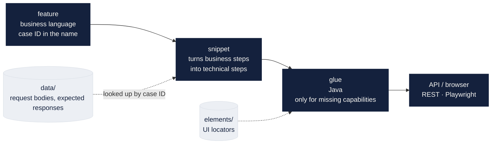
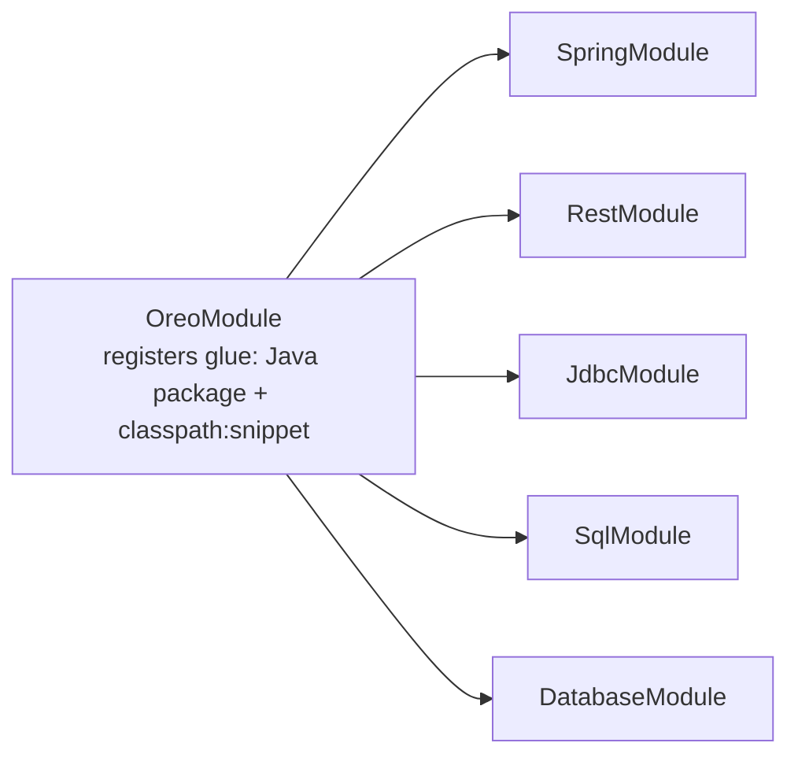
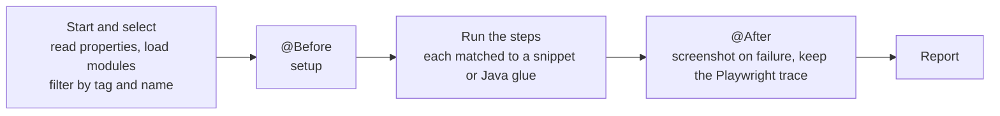
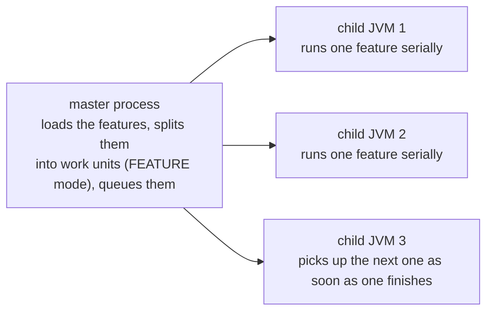
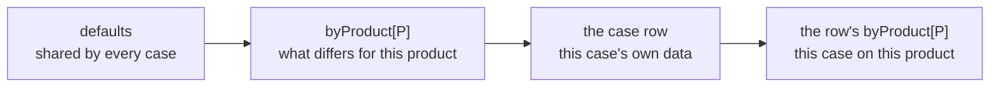
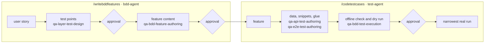

<!--
Confluence content for the onboarding KT (the slides are docs/demo/oreo-kt-deck.html).
One "# Page" heading per Confluence page: create a parent page and one child page per section, then paste each part.
Confluence Cloud converts pasted Markdown; a ```mermaid block goes into a Mermaid macro (or redraw it with draw.io).
Rules and details stay in the repository: these pages summarize them and link to CLAUDE.md and docs/.
-->

# Page: OREO E2E automation framework overview (parent page)

oreo-e2e is the end-to-end test automation project of the OREO FX trade management portal, built on the company's
Genie framework (Java + Cucumber). It covers the whole trade lifecycle: creation, approval, amendment, cancellation,
early termination, allocation, fixing and more.

**Core design: events are files, products are rows.** Each lifecycle event has its own feature file. A new product is
one more row in the Examples and reuses the cases of every event. Products go live one at a time, and this keeps the
cost of covering each one as low as possible.

| Child page | Contents |
|---|---|
| Structure | Layers, directories, API versus UI, where a change goes, tracing a case |
| How Genie runs | Entry point, modules, snippets, lifecycle, configuration, parallel runs |
| Test data | Case IDs, the four-layer merge, recordings and offline checks |
| AI workflow | The two pipelines, agents and skills |
| Hard rules and troubleshooting | The five rules newcomers break most often, and which layer to check first |

**The repository is the source of truth.** These pages are an overview; the detailed rules live in `CLAUDE.md` and
`docs/` in the repository. When the two disagree, trust the code and the repository documents.

---

# Page: Structure

## The layers at a glance

A case goes through four layers between its business description and the call into the system. The further left, the
closer to business language; the further right, the closer to the implementation. Technical details only sink to the
right: they never appear in a feature.



| Layer | What it holds | Location |
|---|---|---|
| feature | Business language; the case ID is in the scenario name | `src/test/resources/features/{api,ui}` |
| snippet | Turns business steps into technical steps | `src/main/resources/snippet/{api,ui}` |
| glue | Java, only for what snippets and built-in steps cannot do | `src/main/java/com/example/module/oreo/glue/{api,ui,hooks}` |
| API / browser | The actual calls into the system: REST, Playwright | Genie built-in modules |

Two kinds of data sit outside this chain and are used by the layers:

- **data/**: request bodies and recorded expected responses, looked up by case ID.
- **elements/**: UI locator JSON. Selectors never go into a feature or get hard-coded in Java.

## Directory map

| Directory | What goes there |
|---|---|
| `features/api`, `features/ui` | One directory per domain, one feature per event |
| `snippet/api` | API business actions and outcome assertions |
| `snippet/ui/flows`, `pages`, `components` | The three UI levels: business flows, atomic page actions, shared components |
| `glue/api`, `glue/ui`, `glue/hooks` | Java step definitions and hooks |
| `data/api`, `ui`, `setup`, `dat`, `common.json` | Case data, precondition data, product dat files, shared blocks |
| `elements/pages`, `components` | UI locators |
| `*.properties` | Environment addresses, accounts and run modes |

Snippets and glue are in `src/main`; features, data, elements and properties are in `src/test/resources`.

## What API and UI cases test

| | `@api` | `@playwright` |
|---|---|---|
| Tests | Business rules: field validation, state transitions, approval, responses | Whether a user can do it: page flows, messages, what the blotter shows |
| Role | Fast and stable, the bulk of the coverage | Critical paths only |

UI preconditions are provisioned through the API, for example `a Live '<product_type>' trade exists in the blotter`.
Such a step does not sign in or navigate, and stores the trade ID in `createdTradeId`. A UI scenario never calls an API
snippet directly.

How to choose the layer: `docs/standards/test-layering-standards.md`.

## Where a change goes

Go down the list and stop at the first that fits:

1. An existing flow, page, component or API snippet expresses it → reuse it.
2. A Genie built-in step does it → use it inside a snippet.
3. Existing glue (`glue/api`, `glue/ui`) does it → call it from a snippet.
4. Compose a new snippet from the above.
5. None of these → only then write new Java, one capability at a time.

Older code has wrappers, `Thread.sleep()` and direct RestAssured calls. Do not copy them, and do not refactor them as a
side effect of another change. The full rules: `CLAUDE.md` sections 3 and 4.

## Tracing a case end to end

1. **Find the scenario** by the case ID in its name, for example `[TC-TRADE-CREATION-...-API-001]`.
2. **Jump to the snippets**: expand each step level by level, down to a built-in step or a Java method.
3. **Print the data**: the `case` command shows the request that is sent and the expected response it is compared with.
4. **Run it once**, on the company machine, with the narrowest filter.

```bash
# Print the data of one case (offline)
mvn -Ptest-data process-test-classes "-Dexec.args=case TC-..."

# Run only this case
mvn -B test -Dtest=OreoTest "-Dcucumber.options=--name ^\[TC-...\].*$"
```

---

# Page: How Genie runs

## What Genie is

The company's in-house test framework, built on Cucumber-JVM and JUnit. It packages REST, databases, Playwright,
reporting and parallel runs as **modules**, so a project only writes its business steps.



Genie loads the modules in dependency order at startup, and each module brings its own built-in steps. Before writing a
new step, check the built-in step catalogs: `docs/genie_rest_glue_catalog.md` and `docs/genie_playwright_glue_catalog.md`.

## Entry point: the three annotations of OreoTest

| Annotation | What it does | Remember |
|---|---|---|
| `@RunWith(Genie.class)` | Genie takes over the JUnit run | `mvn test -Dtest=OreoTest` runs Genie |
| `@CucumberOptions` | Where the features and glue are, default tags | Glue comes from two places: the Java package and the snippets |
| `@GenieOptions` | Environment file, parallel mode | `qa.properties`, FEATURE mode, 3 at a time |

> **Note:** the fixed tags are `not @wip` and `@ADO#trade_creation`, and a command-line filter is combined with them.
> So `mvn test` is not the whole suite; when a run selects 0 cases, check the tags first. Select cases with
> `-Dcucumber.options` only, never `-Dcucumber.filter.*`.

`SeedTest` is a separate entry point that books the SIT seed for UAT. It is not a test and `mvn test` does not run it
(see `docs/sit-seed.md`).

## Snippets: step definitions written as text

```text
# snippet/api/common_api.snippet
@Given "^start a new api request as user '([^']*)'$"
    Given start building a new request
    And set the user header for '$1'
    And set a new request id header
```

- **The first line is a regex**; `$1` is the captured parameter, for example `maker` or `checker`.
- **The lines below are the expansion**: built-in steps, other snippets or Java glue, expanded level by level.

This is how a feature stays in pure business language: the technical details all sink into snippets and glue.

## The lifecycle of a scenario



- **Scenarios share no state**: every scenario gets new glue instances.
- **Steps pass values through stored variables**, for example `from stored variable 'createdTradeId'`.

Hooks are in `glue/hooks/`. Whether a trace is kept is set by `oreo.playwright.trace.mode` in `genie.properties`
(default `RETAIN_ON_FAILURE`).

## Configuration and environments

| File | Contents |
|---|---|
| `genie.properties` | Shared defaults: Edge browser, headless, timeouts, trace mode, risk engine in MOCK mode, element file paths |
| `<env>.properties` | Addresses and accounts per environment: dev, sit, qa, uat, pt; qa by default, set by `@GenieOptions` |

Switching the environment:

```bash
-Dgenie.properties=./src/test/resources/<env>.properties
```

Addresses and accounts live only in the properties files: never in code or features, and never committed. Accounts are
looked up by role through `config/TestUser`.

## Parallel runs: processes, not threads



| | |
|---|---|
| Why processes | Cucumber-JVM is not thread-safe |
| DISCRETE directories | Each child has its own temporary directory: read files through the classpath, never by relative path |
| What this asks of a case | Never depend on data another feature changes, such as a fixed trade, portfolio or user setting |

More forks is not always faster: each child is a full JVM, and UI cases also start their own browser. Details:
`docs/genie-parallel-execution.md`.

---

# Page: Test data

## The case ID is the key to the data

Take `TC-TRADE-CREATION-FX_TRF-API-001`:

| Part | Meaning |
|---|---|
| `TC` | Prefix |
| `TRADE-CREATION` | Event: `data/api/trade_creation.json` |
| `FX_TRF` | Product (a composition) |
| `API` | Layer: API or UI |
| `001` | Number: the row in the data |

- The case ID is in the scenario name, **never a tag**.
- A product is a composition (such as `FX_CO`), not a product ID (such as `FX_PSCRIPT`).
- An ID without a product part is a case that does not depend on the product.

## Four layers, each overriding the one before



Three merge rules:

| Type | Rule |
|---|---|
| Objects | Merged key by key |
| Arrays and values | Replaced whole; nothing is appended |
| `null` | Removes the field |

A row exists only for a case that differs from the defaults: a positive case usually needs none. Every layer is
optional; `use` can reference `common.json`, the event file's own `shared` block, or a setup file in `data/setup/`.
Details: `docs/test-data.md`, section "Case data".

## Recording, syncing and offline checks

| Situation | What to do |
|---|---|
| A new case runs for the first time | With no recording, the response is written into `src` and the case fails once; review the recording, then run again |
| See what a case sends | `TestDataTool`'s `case <ID>` |
| Fields that change on every run | Add a `dynamicFields` rule to mask them, then `compact <event>` |
| A new product or capability | Register it in `ProductDatFiles`, then generate the Examples with `sync-examples` |
| Before committing | `mvn -Ptest-data process-test-classes` (unit tests + check) |

> **Note:** a recording shows what the system **did**, not what it **should do**. When a recorded response disagrees
> with the requirement, stop and ask instead of accepting it. Expected files and Examples are never edited by hand.

Every command is described in `docs/test-data.md`, section "Commands".

---

# Page: AI workflow

Two pipelines, with a human approval at each step.



| Command | Agent | Input → output | Skills |
|---|---|---|---|
| `/writebddfeatures` | bdd-agent | story → test points → feature files | qa-layer-test-design, qa-bdd-feature-authoring |
| `/codetestcases` | test-agent | feature → running cases | qa-api-test-authoring, qa-e2e-test-authoring, qa-bdd-test-execution |

A product defect a run finds is drafted as an ADO Bug with `qa-defect-reporting` and created only after it is approved.

What the AI produces goes through human approval and code review like any other change. The full description:
`docs/ai-workflow.md` in the repository.

---

# Page: Hard rules and troubleshooting

## Five hard rules

1. API runs **book real trades**: always use the narrowest filter.
2. `mvn test` is not the whole suite: it has fixed tags; select cases with `-Dcucumber.options`.
3. Examples and expected responses are **never edited by hand**: use `sync-examples`, and `compact` after recording.
4. No endpoints, request bodies or selectors in a feature.
5. Never commit accounts, passwords, environment addresses or real trade IDs.

The full list: `CLAUDE.md` section 4 (Hard stops).

## Which layer to check first

| Symptom | Check first |
|---|---|
| Step undefined | Does the snippet's regex match; is the glue path right |
| 0 cases ran | Is the filter combined with the fixed tags empty |
| Passes alone, fails in parallel | Shared state, or a relative path |
| Cannot connect, or 401 | Which properties file is used; is the account right |
| Differs from the expected response | An unmasked dynamic field, or did the system's behavior really change |

The last one takes the most judgment: if the behavior changed, check it against the requirement to decide whether it is
a defect or a changed requirement. Never just record it again.
